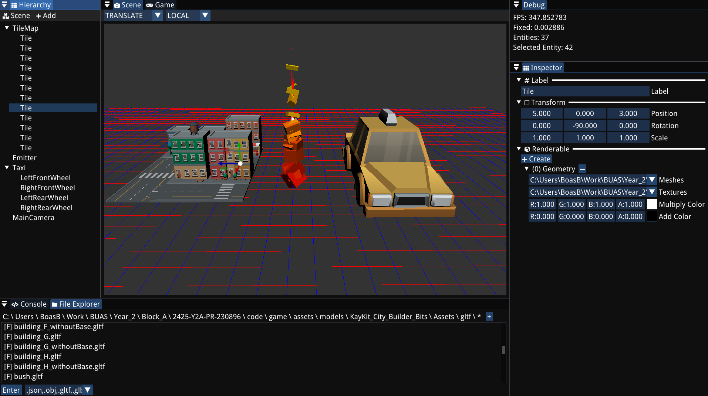
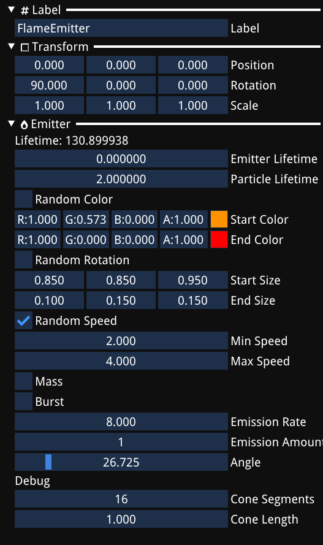

In the [Bee Engine](/projects/bee-engine/) editor, any component can be shown in the inspector and saved to a file just by registering it once, using EnTT's `entt::meta` runtime reflection. The editor and the serializer have no code for any specific component. This was the extra feature I added on top of the deliverables for the Engine & Tools block this project was a part of, my friend Justin helped me a lot with getting the initial setup for `entt::meta` working.



## The problem

The engine uses EnTT as its ECS. Entities are just IDs and components are plain structs, without a shared base class or virtual functions. But the inspector needs to go through whatever components the selected entity has and show their values. And saving an entity or a scene needs to do the same thing, but write the components to JSON with the cereal library.

Without reflection, every new component means changing the inspector and the serializer as well.

## Registering a component

I made two template functions. `RegisterInspectorMeta` registers a component for the inspector, and `RegisterSerializationMeta` registers it for saving and loading. Both store the name you give them as a property on the `entt::meta_type`, but under a different key, `ComponentName` for the inspector and `TypeName` for serialization. That way, when you loop through the registered types, you can tell if a type is registered for the inspector, for serialization, or both.

The inspector registration also adds a `GetType` function, so you can get the actual component from an entity at run-time without knowing its type.

```cpp
template <typename Type>
void RegisterInspectorMeta(const std::string& name)
{
    entt::meta<Type>()
        .prop(entt::hashed_string("ComponentName"), name)
        .template func<&Type::DrawInspector>(entt::hashed_string("DrawInspector"))
        .template func<&GetType<Type>, entt::as_ref_t>(entt::hashed_string("GetType"));
}

template <typename Type>
void RegisterSerializationMeta(const std::string& name)
{
    entt::meta<Type>()
        .prop(entt::hashed_string("TypeName"), name)
        .template func<&SaveType<Type>>(entt::hashed_string("SaveType"))
        .template func<&LoadType<Type>>(entt::hashed_string("LoadType"));
}
```

Registering a component is then one line per system.

```cpp
RegisterInspectorMeta<Transform>(ICON_FA_BORDER_STYLE " Transform");
RegisterInspectorMeta<ParticleSystem::Emitter>(ICON_FA_BURN " Emitter");

RegisterSerializationMeta<Transform>("transform");
RegisterSerializationMeta<ParticleSystem::Emitter>("emitter");
```

## The inspector

The inspector loops through all registered `entt::meta_type`'s and checks if the storage for that type contains the selected entity. If it does, it gets the component with `GetType` and invokes its `DrawInspector` function, which draws the member variables with ImGui.

```cpp
for (auto&& [componentID, metaType] : entt::resolve())
{
    const auto* storage = Engine.Registry().storage(componentID);

    if (storage != nullptr && storage->contains(m_selectedHierarchyEntity))
    {
        auto getter = metaType.func(entt::hashed_string("GetType"));

        if (!getter) continue;

        auto component = getter.invoke({}, entt::forward_as_meta(Engine.Registry()), m_selectedHierarchyEntity);

        if (auto drawFunc = metaType.func(entt::hashed_string("DrawInspector")))
        {
            //.. some imgui formatting around the components

            (void)drawFunc.invoke(component);
        }
    }
}
```



## Saving and loading

Entities get saved through an `EntityWrapper` with a `save` and a `load` function. Saving loops through all component storages, and for every component the entity has that is registered for serialization, it calls `SaveType`. Loading first creates a new entity and then calls `LoadType` for every registered type.

But how do you know which components are actually in the file? I used `try` / `catch`. `LoadType` adds the component and tries to load it from the JSON. If that fails, the component wasn't in the file, so it gets removed again and the next type is tried.

A whole scene is saved as a `std::vector<EntityWrapper>` with only the root entities in it. An entity serializes its children as well, so saving all the roots saves everything in the scene.

```cpp
template <typename Type>
void LoadType(cereal::JSONInputArchive& archive, entt::registry& registry, const entt::entity entity)
{
    Type& component = registry.emplace<Type>(entity);
    const auto property = entt::resolve<Type>().prop(entt::hashed_string("TypeName")).value().template cast<std::string>();
    try
    {
        archive(cereal::make_nvp(property.c_str(), component));
    }
    catch (...)
    {
        registry.remove<Type>(entity);
    }
}
```
<br>

```cpp
template <class Archive>
void save(Archive& archive) const
{
    for (auto&& [component_id, storage] : Engine.Registry().storage())
    {
        if (storage.contains(entity))
        {
            const auto& component_type = entt::resolve(component_id);

            // skip unregistered components
            if (!component_type) continue;

            if (auto saveFunc = component_type.func(entt::hashed_string("SaveType")))
            {
                saveFunc.invoke({}, entt::forward_as_meta(archive), entt::forward_as_meta(Engine.Registry()), entity);
            }
        }
    }
}
```

This way you can save an entire scene and all the components in that scene, and later load them again in a save way.


## What I learned

Keeping the inspector and the saving apart took me a while to get right. Not every component that gets saved should show up in the inspector, and not everything in the inspector needs to be saved, so I had to keep track of what each component needed. That's why the two registrations store the name under different keys. You can tell from the meta type what it was registered for. The first version only registered `DrawInspector`, and the serialization side came later.

I also learned something about templates. Clang Tidy and ReSharper both flagged the registration functions with "Missing 'template' keyword prior to dependent template name 'func'". When you call a templated function on something that depends on a template parameter, like `entt::meta<Type>()`, the compiler can't tell that `func` is a template, so you have to write `.template func<...>` to tell it.

And one thing I learned the hard way, six hours before the deadline, `Renderable` and `HierarchyNode` stopped loading correctly after some changes I made. I fixed it by giving them an `on_construct`, so they set up what they need as soon as they're created, before the data gets loaded into them.

## Result

Adding a component to the engine now means writing the struct with a `DrawInspector` function and a cereal `serialize` (or `save` and `load`) function, plus the two registration calls. The inspector, saving and loading entities, and saving and loading scenes all pick it up automatically. If a component is registered for serialization but doesn't have the cereal functions, cereal throws its own error saying they're missing.
