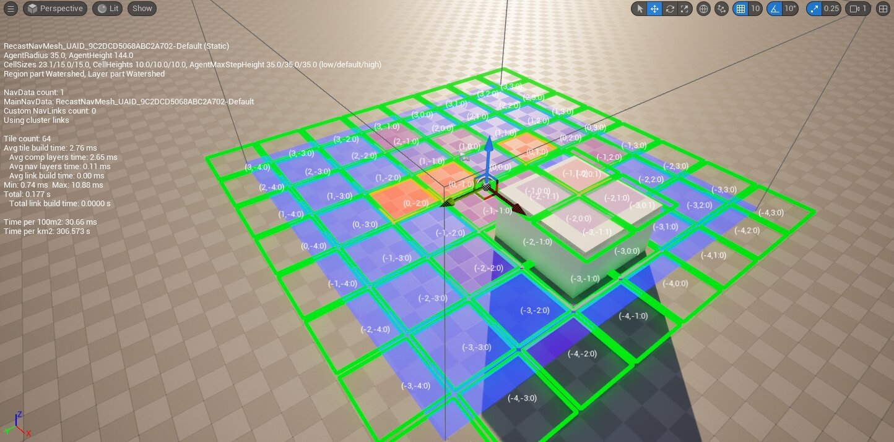
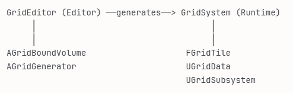
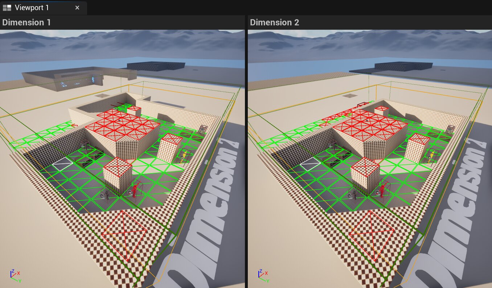
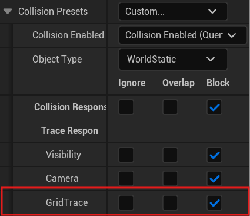
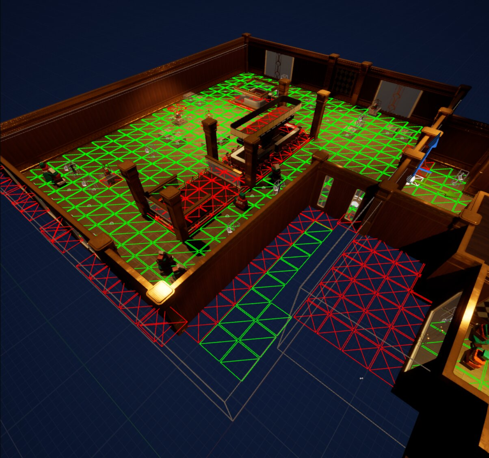
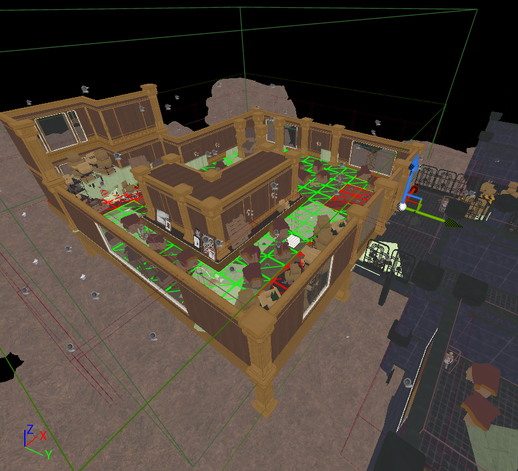
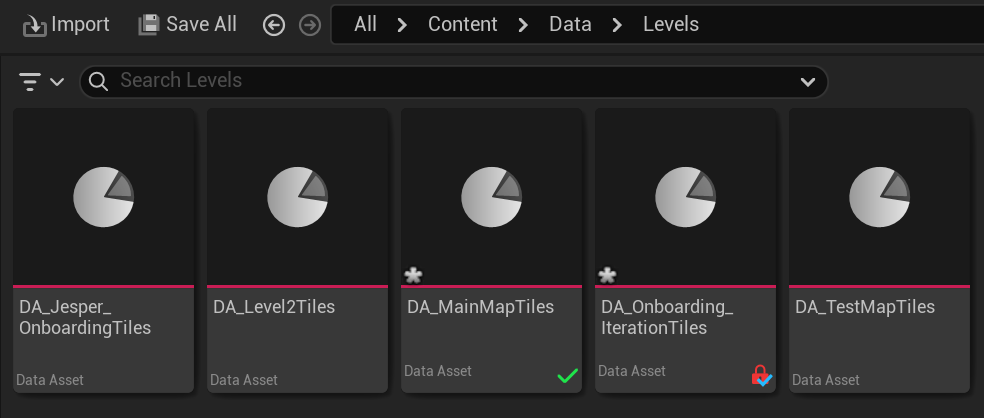
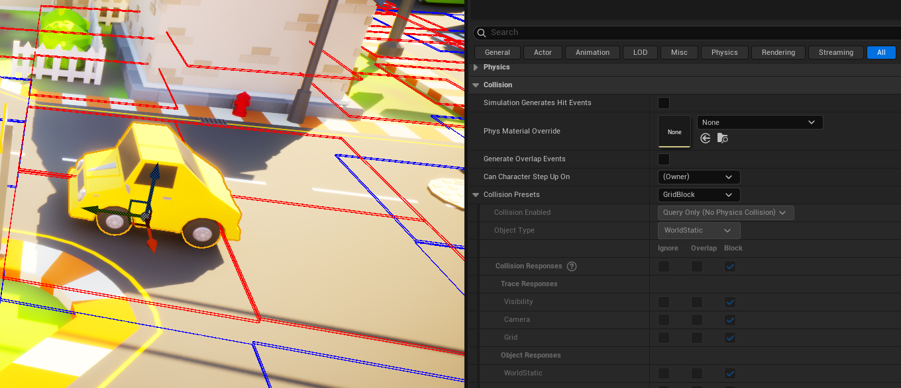
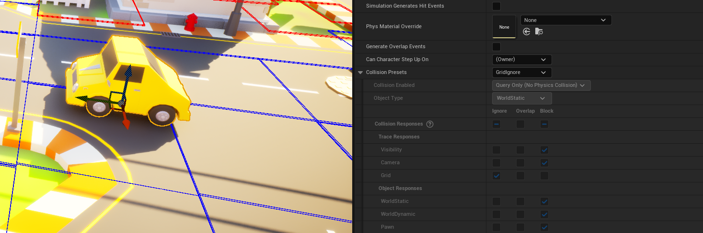

For [PhaseBreak](/projects/phasebreak/), a turn-based tactical heist game in Unreal Engine 5, I built the backend of the grid system. The grid generates its tiles straight from the level geometry, for both of the game's dimensions at once, only re-evaluates the tiles that changed, and saves per level so designers can fix tiles by hand without losing their changes. It got rewritten a few times over three blocks, so this post is about where it ended up.

## What the grid had to do

PhaseBreak has two dimensions that exist in the same physical space. A wall can be there in one dimension and not in the other, so every tile needs its own state per dimension.

On top of that the level designers had to be able to work without me. They build a level, drop a volume over it, and the grid should follow the geometry. Sometimes they need to fix a tile by hand, and those changes have to stay when the grid regenerates.

## The architecture

I based the structure on how Unreal's navigation system works, where the data lives on an actor (`ARecastNavMesh`) and a separate system manages it.



`AGridSystemV1` is an abstract `AActor` that holds all the tile data and keeps track of the grid volumes. `AGridGenerator` is the child class that has the evaluation settings and does the actual queries. The volumes are just shapes for designers to place. They tell the system when their bounds change, but they don't own any data.

The code is split over two modules. `GridSystem` is the runtime module and `GridEditor` has the editor mode and tooling. The game only includes `GridSystem`, so editor code can't end up in a cooked build.



The tile data is stored per dimension. `FTileData` has the tile state, its height, and a `Modified` flag for tiles a designer changed by hand. `FDimensionData` has a `TMap<FIntPoint, FTileData>` for the tiles and a `TMap<FIntPoint, TWeakObjectPtr<AActor>>` for what is standing on them. `AGridSystemV1` has `FDimensionData m_Dimensions[TOTAL_TILE_DIMENSIONS]`.

`TOTAL_TILE_DIMENSIONS` is a single define. The dimension array, the evaluation and the dirty processing all loop over it, so a third dimension would mostly mean changing one number. Every dimension access goes through a check that logs a warning instead of crashing, because the index often comes straight from a Blueprint.

```cpp
bool AGridSystemV1::IsValidDimension(const int32 Dimension)
{
    if (Dimension >= 0 && Dimension < TOTAL_TILE_DIMENSIONS) return true;
    UE_LOG(LogGridSystem, Warning, TEXT("IsValidDimension: Invalid dimension index %d (max %d)"),
        Dimension, TOTAL_TILE_DIMENSIONS - 1);
    return false;
}
```

## Only evaluating what changed

In the first versions, moving a volume re-evaluated every tile inside it. For a 20x20 volume that is 400 queries every time you drag it, which made the editor unusable while building a level.

Now the system keeps a `TSet<FIntPoint>` of dirty tiles. When a volume moves, it compares the old and new bounds and only marks the tiles that left or entered the volume, so the cost depends on how far you moved it, not on how big the volume is. Changing the height marks the overlapping tiles, and changing a setting like the tile size marks everything. The dirty tiles get processed on tick. Tiles with `Modified` set get skipped, so a designer's manual changes don't get overwritten.

## Which dimension geometry belongs to

Both dimensions are overlapping geometry in the same space, so when the evaluation hits something it needs to know which dimension it belongs to. Meshes already had a Custom Primitive Data value for which dimension they belong to, which their materials use. The evaluation reads that same value from each hit component. 0 means dimension one, 1 means dimension two, and geometry without the value counts for both.



## Evaluating a tile

Each tile does one `OverlapMultiByChannel` with a column-shaped box, on its own GridTrace channel. Geometry generates tiles by default, and objects that shouldn't can opt out by setting their GridTrace response to Ignore.



To check if geometry actually covers a tile, and not just something close to its center, the tile is split into a grid of cells. Each cell gets checked against the XY bounds of the overlapping components, and the tile is valid if enough of the cells are covered. The height comes from the top of the component bounds. When multiple components overlap a tile, designers can pick the lowest, the highest or the median height. Median is there for geometry with outliers, like thin trim that sticks out above the floor.

```cpp
for (int32 cy = 0; cy < resolution; ++cy)
{
    for (int32 cx = 0; cx < resolution; ++cx)
    {
        const float cellMinX = tileMinX + cx * cellSize;
        const float cellMaxX = cellMinX + cellSize;

        // ...skip this cell if it's blocked

        for (const FCompBounds& b : dimValid[dim])
        {
            if (Overlaps2D(cellMinX, cellMinY, cellMaxX, cellMaxY,
                b.MinX, b.MinY, b.MaxX, b.MaxY))
            {
                validCells++;
                break;
            }
        }
    }
}

const float coverage = static_cast<float>(validCells) / static_cast<float>(totalCells);
if (coverage >= MinCoveragePercent * 0.01f)
    OutResults[dim].TileState = ETileState::VALID;
```
<br>

```cpp
allHeights.Sort();
switch (HeightMode)
{
  case ETileHeightMode::Lowest:
    OutResults[dim].Height = allHeights[0];
    break;
  case ETileHeightMode::Highest:
    OutResults[dim].Height = allHeights.Last();
    break;
  case ETileHeightMode::Median:
    OutResults[dim].Height = allHeights[allHeights.Num() / 2];
    break;
}
```

Before this rework there were tiles in places with no geometry. After it, there aren't.





## Saving the grid

Each level stores its grid in a `UGridDataAsset`. The generator points to it with a `TSoftObjectPtr`, so the cooker follows the reference into the build and the asset isn't loaded until it's needed.



When the grid changes it fires a delegate. The handler compares the data in memory with the asset and marks the asset dirty if something changed, so designers get the normal Unreal "unsaved changes" flow. That was also what they wanted, because they didn't want temporary changes while testing in PIE to overwrite the saved grid.

```cpp
OnTilesChanged.AddUObject(this, &AGridSystemV1::SyncDataAsset);
OnTileSizeChanged.AddUObject(this, &AGridSystemV1::SyncDataAsset);
OnTileOffsetChanged.AddUObject(this, &AGridSystemV1::SyncDataAsset);
```
<br>

```cpp
void AGridSystemV1::SyncDataAsset()
{
    UGridDataAsset* dataAsset = GridDataAsset.LoadSynchronous();

    // ...compare the data in memory with the data in the asset

    if (changed)
        dataAsset->Modify();
}
```

## What I considered

- **A `UWorldSubsystem` instead of an actor.** That would work fine for storing the data, but a subsystem has no actor in the world, so there is no details panel where designers can change the tile size, coverage or trace channel. Keeping it on an actor gives them something to click on.
- **Other ways to tell the dimensions apart.** I looked at a trace channel per dimension, actor tags, and a separate query per dimension. Channels and tags both need setup on every asset, and two queries doubles the cost. The CPD value was already on every mesh.
- **A component on blocking objects.** The older version used a component that designers had to add to every object that should block tiles. They never used it, because set dressing first had to be turned into an actor. The trace channel replaced it.

<div class="image-pair">
  <div class="scroll-box"></div>
  <div class="scroll-box"></div>
</div>

## What I learned

Saving caused more bugs than anything else in this system. My first auto-save called `UPackage::SavePackage` on every change. When a designer dragged a volume that meant a lot of writes really fast, the Windows file operation failed, and the editor crashed. Forcing a save on startup crashed the engine on launch for the same reason. The fix was to stop writing to disk myself and let Unreal's own dirty and save flow handle it with `Modify()`.

The other lessons were less about code and more about working on a system everyone else depends on. In my peer reviews, Lasse and Jim both pointed out that I didn't document my changes to the grid, so after a refactor the only way for someone else to understand it was reading the code. Timmy, who was doing the profiling and optimization that sprint, pointed out that I didn't include him in my plans, even though I was working on the cover tile recalculation in the same area. I tend to work through a problem on my own before bringing anyone in. That's fine when the work is self-contained, but not when it touches a shared system or someone else's task. So for next time I want to check in with whoever is responsible first, or bring it up at standup, and document my changes for both the designers and the programmers.

I also had to learn when to stop. Near the end of the project I started splitting the grid system up more cleanly, without making a task for it first. It grew into 12 hours of work before I told Iddo, our lead programmer, and once we talked about it, it was clear it wasn't worth it. Finishing it meant checking out the whole grid system, blocking the other programmers, and replacing every grid Blueprint node right before release. The idea itself wasn't the problem, it was that I kept going without checking in, even though I could see the scope growing. Jim and Lasse also both told me in my peer reviews to stop trying to make systems perfect. Next time I'll bring a task like that up at standup or sprint planning first, with a clear point where I stop.

## Looking back

The evaluation is still not fast. Big maps mean a lot of physics queries. Doing one overlap for the whole volume and calculating the coverage from the component bounds myself would cut that down a lot, but bounds are less accurate than the actual mesh shape.

I iterated on this system a lot and mostly judged it by whether it felt right in the editor.
