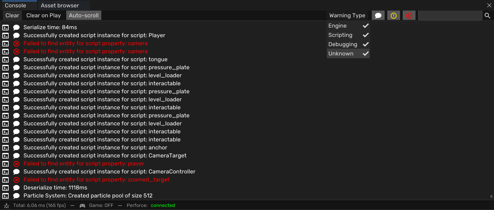
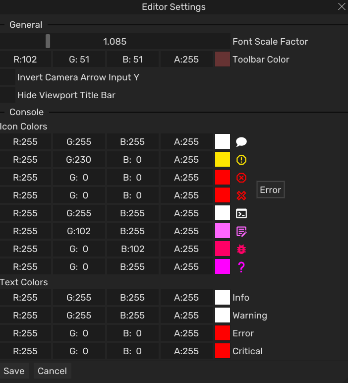
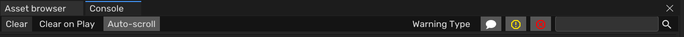

The engine console in [Zentera](/projects/zentera/), made in our custom Kudzu engine, captures everything the engine and its libraries print, writes it to a log file, and shows it in an ImGui window with filters and search. It became one of the most used debugging tools on the team. Gameplay programmers used it all the time to check their scripts, and because artists and designers don't have a debugger, the log file was often the only way to find out why the engine crashed on their machine.



It started as my task for the first sprint, a console so designers and gameplay programmers could debug while running the engine without a debugger. I didn't want to change our existing `Log` class too much, and I also wanted to catch messages from external libraries like AngelScript, which don't use our `Log` class at all.

The system has two parts. The logger captures all the output and writes it to a log file. The console is mostly UI that shows and filters those messages.

## The logger

The logger lives in the `kudzu::logger` namespace instead of a class, because there should only ever be one logger. Everything goes through `stdout` and `stderr`, so the solution was to take control of those two streams. In `initialize()` both get redirected to our own log file. I used `_dup` to save the original file descriptors first, and `_dup2` to point the streams at the log file.

```cpp
namespace kudzu::logger 
{
void initialize();
void shutdown();
bool flush_log();

void hide_console();
void show_console();

std::string get_log_content();
std::string get_log_content_from_position(size_t start);
size_t get_log_size();
};
```

```cpp
fopen_s(&log_file, KUDZU_LOG, "wb+");

AllocConsole();
console_window = GetConsoleWindow();
hide_console();

// reopen the stderr and stdout to our console
FILE* empty = nullptr;
freopen_s(&empty, "CONOUT$", "wb", stdout);
freopen_s(&empty, "CONOUT$", "wb", stderr);

// create a file descriptor for out streams
stdout_fd = _dup(_fileno(stdout));
stderr_fd = _dup(_fileno(stderr));

// reassign our streams to the log
_dup2(_fileno(log_file), _fileno(stdout));
_dup2(_fileno(log_file), _fileno(stderr));

// set the buffer behaviour
setvbuf(stdout, nullptr, _IOLBF, BUFSIZ);
setvbuf(stderr, nullptr, _IONBF, 0);
```

## Reading the log back

The console gets new text from the logger with `get_log_content_from_position()`. It saves the current file position, jumps to the start point, reads everything after it into a string, and then restores the original position so writing can continue where it was.

```cpp
std::string get_log_content_from_position(const size_t start) {
    if (!flush_log()) return "";

    const size_t file_size = get_log_size();

    if (start >= file_size) {
        return "";
    }
        
    const long current_pos = ftell(log_file);

    (void)fseek(log_file, static_cast<long>(start), SEEK_SET);

    std::string result;
    result.reserve(file_size - start);

    char buffer[4096];
    size_t bytes_read;

    while ((bytes_read = fread(buffer, 1, sizeof(buffer), log_file)) > 0) {
        result.append(buffer, bytes_read);
    }

    (void)fseek(log_file, current_pos, SEEK_SET);

    return result;
}
```

## The console window

Every line in the console is a `ConsoleLine` with a warning level and a type. In `parse_log_content()` there's an early out if the log hasn't grown, otherwise it reads only the new part and turns each line into a `ConsoleLine`, removing tags like `[Info]`, `[Warning]` and `[Error]` from the text. Then the filters get applied to a second list, so the UI only draws the filtered lines.

The colors of the icons and text can be changed and get saved in `editor_settings.json`. Sven had already set up most of the saving and loading for the editor settings, so I only had to add the variables and some helper functions.



```cpp
enum class WarningLevel : uint8_t { INFO, WARNING, ERROR, CRITICAL };
enum class WarningType : uint8_t { ENGINE = 0, AS_SCRIPTING, AS_DEBUGGER, UNKNOWN };
struct ConsoleLine {
    std::string text;
    WarningLevel level;
    WarningType type;
};
```

```cpp
const size_t current_log_size = logger::get_log_size();
if (current_log_size <= last_log_position) {
    return;
}

const std::string new_content = logger::get_log_content_from_position(last_log_position);
last_log_position = current_log_size;

//.. parse the engine specific tags to get the types and warning levels

apply_filters();
```

The console ended up with a clear button, clear on play (a feature request from Sven, because while debugging scripts you'd lose track of which errors were old and which were new), auto scroll, filters for the warning level and the message type, a search bar, and customizable colors.



## What I considered

- **C streams instead of C++ streams.** I used the C way with `FILE*` instead of `std::ostream`, because it gave me more control over the file streams and better device support.
- **One line instead of all of this.** After some testing I found most of the redirect could be one `freopen_s(&log_file, KUDZU_LOG, "wb+", stdout)`. But that only catches `stdout`, not `stderr`.
- **`std::regex` for parsing.** I didn't want to use regex for such simple text matching, so the parsing is a series of `string::find()` calls with `if` and `else if`. It works, but it isn't very elegant.
- **Printing to both the file and the console window.** I looked into this and found a technique called a tee, but after talking to Jaeden and Sven we scrapped it because of time.

## What I learned

The biggest thing I learned was how `stdout` and `stderr` work under the hood. Everything an application prints, including the libraries you don't control, goes through those two streams, so they're the one place where you can catch all of it. Saving the original file descriptors with `_dup` before redirecting made the difference, because it means you can always get the original streams back.

It also showed me not to trust a shortcut just because it looks like it works. The one-line `freopen_s` version looked fine while testing, but it only caught `stdout`. And even my full version didn't capture `stderr` properly in the end, which I only found out later.

And I learned how much a small tool can matter once other people rely on it. For the artists and designers, the log file was the only way to tell us why the engine crashed on their machine, so the console had to keep working in release builds too, not just in the editor.

## Looking back

Not everything got finished. Copying console lines got pushed back because other features had priority, and the Debugger message type exists but the scripting engine never uses it. At the time I wrote my ILO, `stderr` also wasn't captured properly yet, so I made an issue and a pull request to fix it.
