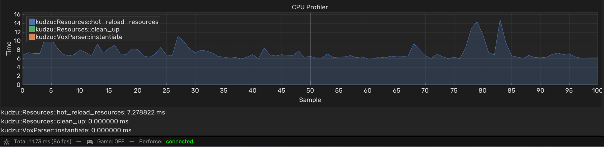
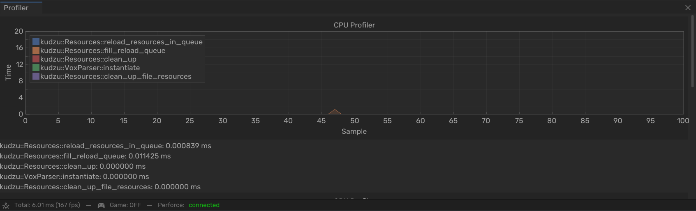

The hot reloading system in [Zentera](/projects/zentera/), made in our custom Kudzu engine, reloads any resource the moment its file changes on disk. Artists and designers can edit a voxel model in MagicaVoxel, save it, and see it update in the engine right away without restarting. Near the end of the project the first version had gotten slow enough to drag the whole editor down, so I redesigned it. It went from 7.28ms to 0.012ms per frame, about 910 times faster.

<video src="/assets/video/projects/zentera/hot_reload.mp4" width="100%" height="100%" controls title="Hot Reloading"></video>

## Why hot reloading

In the second sprint I was supposed to build a blockout tool, so designers could quickly build levels inside the engine. In the FPOC meeting I brought up that I thought it wasn't necessary: if the engine could hot reload resources, designers could build blockouts in MagicaVoxel and the `VoxelModel` would reload in the engine every time they saved. After talking it through with Axel, our designer, we cancelled the blockout tool and I worked on hot reloading instead.

## The first version

The system works for any resource that inherits from the `Resource` class. Each `Resource` stored a `uint64_t last_time_modified`, and every frame the system looped through all resources and compared that to the file's actual modification time. If it changed, it called that resource's `reload()`.

Scripts (`.as` files) are skipped. They can't be reloaded one at a time, because scripts depend on each other and the whole scripting engine has to be rebuilt.

When a reload fails, the timestamp is intentionally not updated, so it tries again the next frame. That matters for programs that save with an atomic write, like Paint does for images. During an atomic write the file can briefly not exist. If the system notices the change in that moment, the reload fails, and retrying on the next frame gives the save time to finish.


After a reload, `clean_up()` removes resources that aren't used anymore, mainly the temporary `VoxParser` objects that `VoxelRenderer::reload()` creates.

```cpp
bool hot_reloaded = false;
for (auto& [id, resource] : resources) 
{
    if (resource->type == AssetType::SCRIPT) continue;

    const uint64_t last_time_modified = Engine.files().last_modified(resource->directory, resource->filename);

    if (last_time_modified != resource->last_time_modified && last_time_modified != 0) {
        // check if reload succeeded for files with atomic write operation
        if (resource->reload()) {
            resource->last_time_modified = last_time_modified;
            hot_reloaded = true;
        }
    }
}
if (hot_reloaded) clean_up();
```

## It got slow

At the end of sprint 4, Max noticed the editor had become slow after all the new art was added. He and Sven profiled it and found the hot reloading. By then the game had so many resources that looping through all of them every frame took **7.28ms per frame** on average, with spikes up to about 14ms, and the editor dropped from 167fps to 86fps. That was way higher than when I profiled it in the first few weeks, when there were far fewer assets.



I already had some ideas for improving it when I first made it, but it was fine at the time. Now I made three changes.

## Check files instead of resources

I moved the timestamp out of `Resource` into a new struct, `FileResource`. It keeps the data of one file and a `std::vector` of ids of all the resources that use it. So when lots of resources use the same file, the file only gets checked once instead of once per resource. Changed files no longer reload right away. Their resources get added to a reload queue.

```cpp
for (auto it = file_resources.begin(); it != file_resources.end();) 
{
    const uint64_t last_modified = Engine.files().last_modified(it->second->directory, it->second->filename);

    if (last_modified != it->second->last_modified && last_modified != 0) {
        Log::Info("Reloading resources tied to: \"{}\".", it->second->filename);

        for (const size_t id : it->second->resource_ids) {
            if (resources.contains(id)) {
                if (resources[id]->type == AssetType::SCRIPT) continue;

                reload_queue[id] = 0;
            }
        }

        it->second->last_modified = last_modified;
    }
    ++it;
}
```

## A reload queue

The queue is an `std::unordered_map<size_t, int>`. The key is the id of the resource to reload and the value is how many times it has tried. Each frame it goes through the queue and calls `reload()`. If that fails, the counter goes up, and once it hits `RELOAD_TIMEOUT` the entry is removed with a warning that the resource couldn't be reloaded. This keeps the retry behaviour for atomic writes from the first version, but now it gives up after a while.

```cpp
bool reloaded = false;
for (auto it = reload_queue.begin(); it != reload_queue.end();) 
{
    const size_t id = it->first;
    int& counter = it->second;
    if (resources.contains(id)) {
        if (resources[id]->reload()) {
            it = reload_queue.erase(it);
            reloaded = true;
        } else {
            ++counter;
            ++it;

            if (counter >= RELOAD_TIMEOUT) {
                it = reload_queue.erase(it);
                Log::Warn("Failed to reload resource \"{}\" after {} attempts!", resources[id]->filename, RELOAD_TIMEOUT);
            }
        }
    } else {
        it = reload_queue.erase(it);
    }
}

if (reloaded) clean_up();
```

## Throttled file checking

The files are only checked every `FILE_CHANGE_BUFFER_TIME` seconds, `1.0f` by default, instead of every frame. The queue itself is still processed every frame.

```cpp
const auto now = std::chrono::steady_clock::now();
if (std::chrono::duration_cast<std::chrono::duration<float>>(now - last_reload_time).count() >= FILE_CHANGE_BUFFER_TIME) {
    fill_reload_queue();
    last_reload_time = std::chrono::steady_clock::now();
}
reload_resources_in_queue();
```

## What I considered

For the queue I compared a map, a set, a stack and a queue. The most important thing was unique keys. If you save a file 2 or 3 times in a row, you don't want the resource in the queue 3 times and reloaded 3 times.

|           | Pros                                                         | Cons                                                   |
| --------- | ------------------------------------------------------------ | ------------------------------------------------------ |
| **Map**   | Unique key, can store the retry count, easy to iterate        | Slower to iterate through                              |
| **Set**   | Unique key, easy to iterate                                   | Slower to iterate through, needs a separate retry count |
| **Stack** | Easy and faster to iterate                                    | Duplicate keys, needs a separate retry count           |
| **Queue** | Easy and faster to iterate                                    | Duplicate keys, needs a separate retry count           |

I went with the map because it has the most benefits here. The downside is that iterating a map is a bit slower, because it's an associative container.

## What I learned

The main lesson was to profile again once the project is real. I did profile the first version in the first few weeks and it was fine, but back then there were only a few assets in the game. The cost grew with every resource that got added, and by the end of sprint 4 it was 7.28ms per frame. A number from early in a project says very little about what something costs at the end of it.

I also learned that you can't just read a file the moment it changes. Programs like Paint save with an atomic write, so for a moment the file isn't there, and a reload at exactly that moment fails. That's why the first version doesn't update the timestamp when a reload fails, and why the queue in the second version retries.

And not every task has to be built the way it was planned. I was supposed to make a blockout tool, but with hot reloading designers could just keep building their blockouts in MagicaVoxel. Bringing that up in the meeting saved us a whole tool.

## Result

After the redesign the hot reloading averages **0.012ms per frame**, down from 7.28ms, and the editor stays at 167fps. Checking the files costs up to about 2ms once per second when it runs, and about 0.0008ms on the frames in between. That once-per-second check is still a small hit, but it doesn't affect the frame rate.


