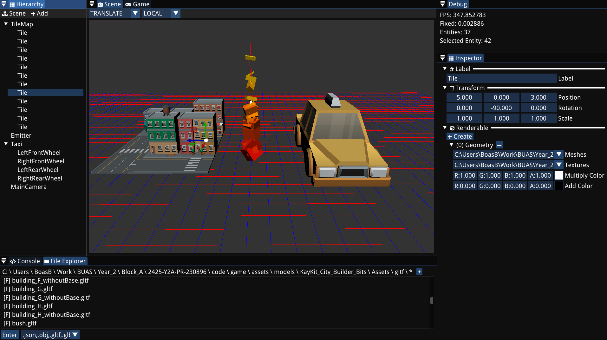
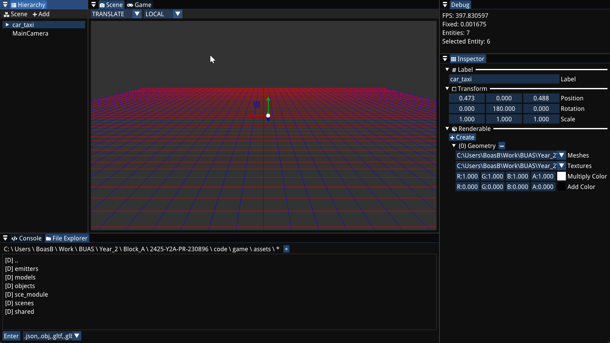

## Overview

This was my first block in the Engine & Tools specialization in my second year at Breda University of Applied Sciences. It was a solo school project starting from the in-house Bee engine, every week had a deliverable, and together they make up a small engine with an editor. You can build a scene, tweak particle effects live, play and pause, and save and load the whole scene.

---

## What I Did

### Game Loop

A fixed and dynamic time step, with play, pause and step controls in the editor. The particle system updates on the fixed time step, and rendering, the editor, audio and input run every frame.

*Gameplay code written in the game's own `Update`, moving a car with the arrow keys.*

### Resources and Saving

A templated resource manager that loads and caches meshes, textures and GLTF models, and serialization with the cereal library that saves entities and whole scenes to JSON.

<a href="/blogs/entt-runtime-reflection/" class="article-button"><i class="fas fa-newspaper"></i> Read the article</a>

### Editor and Inspector

An ImGui editor with a viewport, a file browser, a scene hierarchy and an inspector. You can click objects in the viewport to select them in the hierarchy, and the inspector shows the components of the selected entity. As an extra on top of the deliverables, components register themselves for the inspector and for saving with EnTT's runtime reflection, so the editor has no code for any specific component.

### Particle System

Emitters that spawn particles in bursts or continuously, with settings like the emission rate, lifetime, color and size that you can change live in the inspector.

