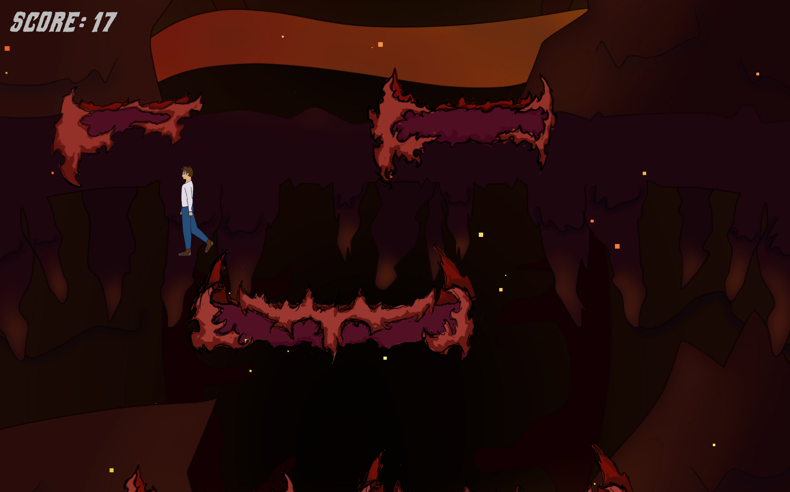

## Overview

A two-week school project at Grafisch Lyceum Utrecht with a team of two programmers and two artists. The assignment was a game with an endless level, but the main goal of the project was learning Scrum. At the start I told the team we'd better make something simple that we could actually finish, so we went with a 2D game. We picked the theme with a poll in the group chat, and Hell won.

The game is a vertical endless runner. Platforms spawn below the camera and move up, and you try to get to the deepest point of Hell to find a portal back to Earth. If you fall out of the camera you die, and your score is the number of seconds you survived.

  <iframe src="https://www.youtube.com/embed/BKa8aL9P0iY" title="Endless Runner Gameplay" frameborder="0" allow="accelerometer; autoplay; clipboard-write; encrypted-media; gyroscope; picture-in-picture; web-share" referrerpolicy="strict-origin-when-cross-origin" allowfullscreen></iframe>

---

## What I Did

### Platform Spawning

The part I'm most proud of. Instead of spawning a platform and removing it again if it overlaps something, the spawner first checks if there is room, and only spawns it if there is. To check what's in the way it compares the layers of everything in that space against a layer mask, which is where I learned how Unity's layer masks and bit shifting work.

### Player

The player movement, jumping, and dying when you leave the camera.

### Scrum Master

I volunteered as Scrum Master and team lead. I reminded everyone of the Scrum tasks, checked in on how everyone's work was going, and when I noticed someone was getting tired of what they were working on, I gave them something else to do or told them to take a break. I also added comments to all the scripts, including the ones Luca wrote.

