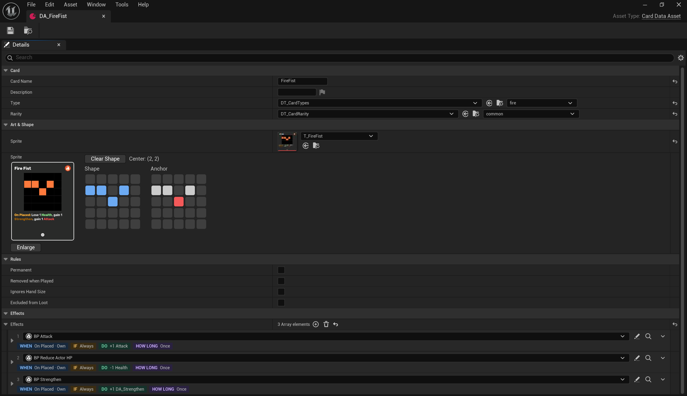
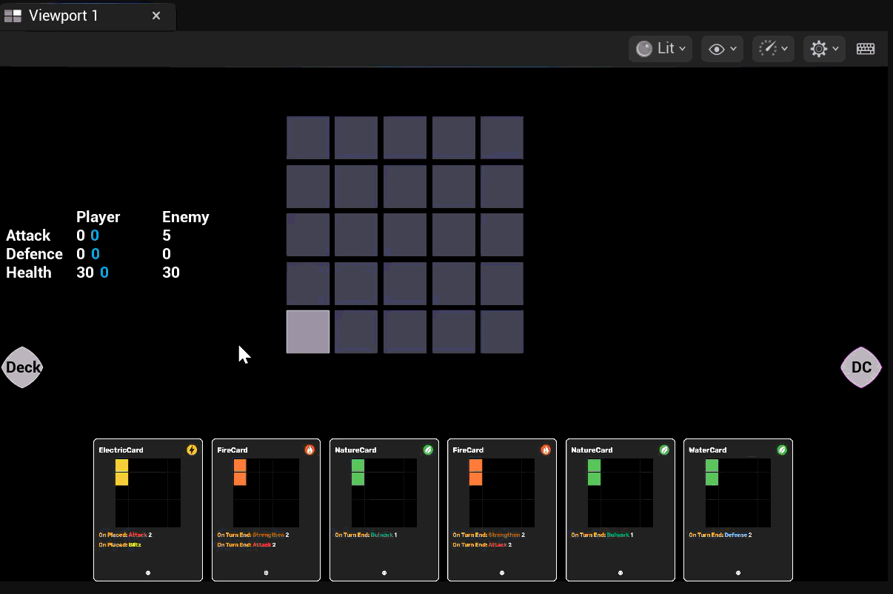
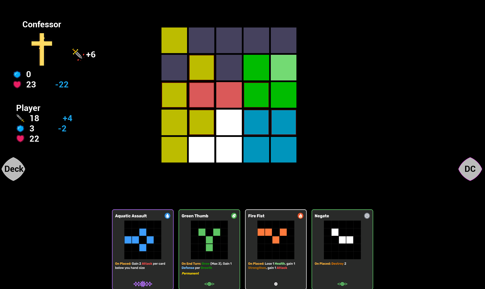
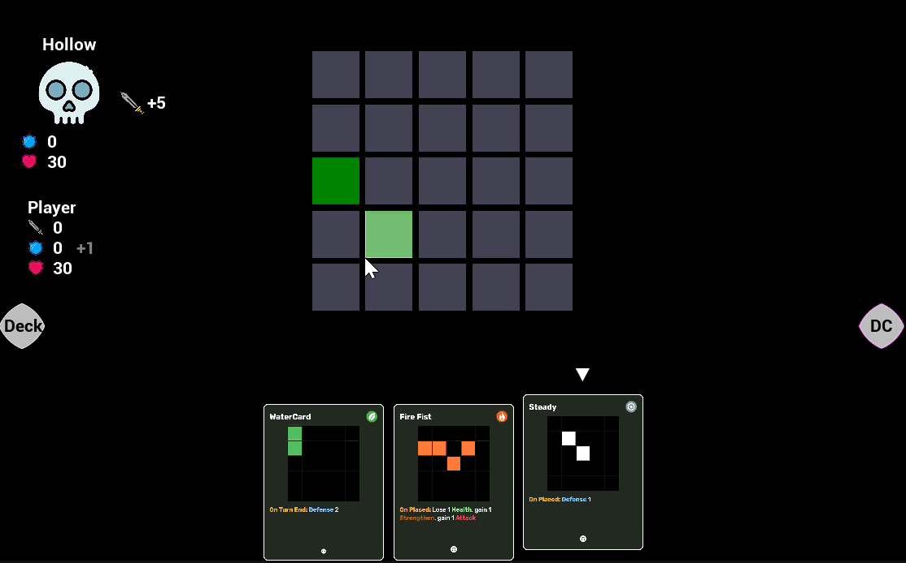
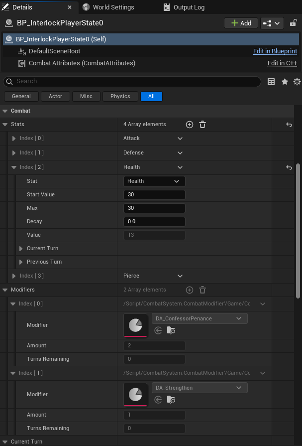

## Overview

Interlock is a roguelite deckbuilder where you play shape cards onto a 4x4 grid. Lining up elements like Fire, Water and Wood sets off combos in combat. The same cards are used to build paths through the overworld, and your hand, deck and discard pile are shared between both, so every card you spend on traveling is one you don't have in the next fight.

It's my graduation-year project at Breda University of Applied Sciences, running over the first semester of my fourth year, with a small team of two programmers and a designer. This page covers what I made in the first quarter.

---

## What I Did

My goal for this project is a card system where the data, like a card's type, shape and effects, is fully separated from the logic that runs it, so new cards can be added without changing code. Most of my work is on the cards, the combat and the enemies.

### Card Data

Every card is a data asset with its type, rarity, shape and effects. The types and rarities come from data tables, so our designer Nick can add new ones without a programmer. Instead of typing a shape in as numbers, you draw it on a small clickable grid in the card's details panel, which I built as a custom editor widget.

### Previewing a Move

Before you end your turn, the game shows what's going to happen. When you hold a card over the grid, the stats show ghost values for what they'll be once the card is placed, and for what they'll be at the end of the turn, so you can see the result of a move before committing to it.

### Enemy Intent

Enemies show what they're going to do this turn above their heads. The enemy decides its move at the start of its turn and only applies it at the end, so the intent you see is what will actually happen. The enemy panel listens for the intent changing, so it updates the moment the enemy decides.

### Combat Stats and Log

Every turn is recorded per stat, with what was kept, gained and lost and how often, so the combat log can show exactly what happened and why. The stats and their modifiers are all set up in the details panel, so they can be tuned in the editor instead of in code. One of the effects I added that way is Pierce, which lets an attack ignore defense.

### Reworking Combat Around Triggers

At the end of the quarter we ran into problems the current setup couldn't handle well. An enemy whose damage depends on your hand size was always wrong, because it decided its damage at the start of the turn, before your hand was refilled. And a new enemy, the Hollow, needed to heal only if its hit actually landed that turn.

So we're reworking combat around triggers with clear phases, from the enemy deciding to the combat resolving and cleaning up. Justin is building the trigger system, and I'm reworking the combat and the enemies on top of it, so enemies only decide what they'll do early, and the actual amounts get calculated as late as possible.
