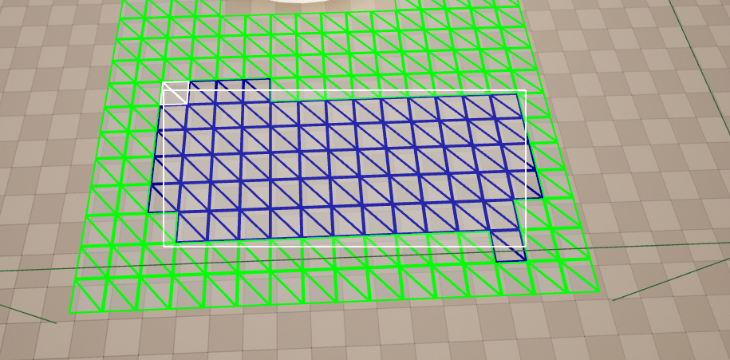
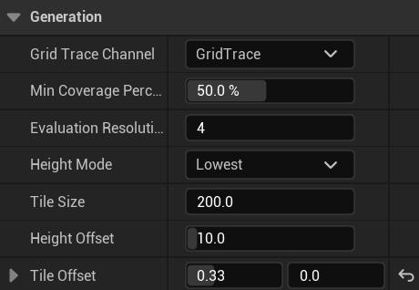
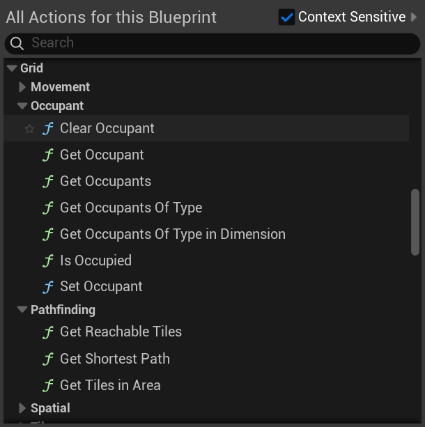
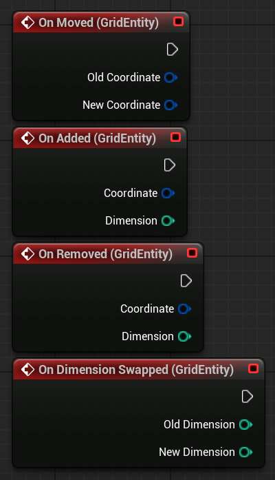

## Overview

PhaseBreak is a turn-based tactical heist game where the level exists in two dimensions at the same time, and you swap between them to get past enemies and obstacles. Warping into a spot that's occupied in the other dimension even damages whatever is standing there. It was the team project of my third year at Breda University of Applied Sciences, made over three blocks by a team of 27 programmers, designers, artists and a producer. We built it in Unreal Engine 5 and released it for free on Steam.

  <iframe src="https://www.youtube.com/embed/aOXhQ45k_58" title="PhaseBreak trailer" frameborder="0" allow="accelerometer; autoplay; clipboard-write; encrypted-media; gyroscope; picture-in-picture; web-share" referrerpolicy="strict-origin-when-cross-origin" allowfullscreen></iframe>

---

## What I Did

I worked on the backend of the grid system. That means generating the grid from the level, making it work for both dimensions, and saving it so designers can change it. Almost everything in the game that moves or stands on the grid, like the units and the covers, goes through it.

### Grid System

Level designers just build their level and place a volume over it, and the grid creates the tiles based on the geometry. It works for both dimensions at the same time, knows which dimension each object belongs to, and only updates the tiles that actually changed. That way moving a volume around in the editor stays fast.

<video src="/assets/video/projects/phasebreak/grid_volume_tile_generation.mp4" width="100%" autoplay muted loop playsinline controls title="A grid volume generating tiles from the level"></video>

<a href="/blogs/phasebreak-grid-system/" class="article-button"><i class="fas fa-newspaper"></i> Read the post</a>

### Designer Tooling

I also made an editor mode where designers can click on tiles in the viewport to make them valid or invalid. Each level saves its grid in its own data asset, so changing a tile marks the grid's data asset as changed, just like any other change in Unreal, instead of needing a separate save button.

<video src="/assets/video/projects/phasebreak/automatic_data_asset_saving_on_tile_changed.mp4" width="100%" autoplay muted loop playsinline controls title="Changing tiles in the tile editor mode"></video>

Tiles that a designer changed by hand stay the way they set them, even when the volume moves or the grid gets rebuilt.

<video src="/assets/video/projects/phasebreak/grid_keep_modified.mp4" width="100%" autoplay muted loop playsinline controls title="Hand-edited tiles staying when the volume moves"></video>

All the settings for how the grid gets generated are on the grid generator, like the tile size, how much of a tile needs to be covered and which height to use. That way designers can change them per level.

### Helping the Team Use the Grid

Because almost every system in the game uses the grid, a big part of my work was helping the others use it. Robin for example came to me with questions for his AI tool, like how to remove an occupant from a tile without destroying its grid entity component, and how to get all tiles of a certain type in the editor. Timmy asked me to help with a performance issue in `DrawGrid`, which we fixed together in a call. Near the end I also added events for when something on the grid gets added, moved, removed or swaps dimension. With those other systems can react when something changes, instead of having to recalculate everything.

  

  

### Shipping the Game

In the last block I mostly fixed bugs to get the game ready for the release. For example the game failing to package, the grid data not loading when going to another level, visual effects not showing on top of the tile they were aimed at, the undo and redo buttons still working while an action was selected, and the telefrag health preview staying visible after swapping dimensions.

