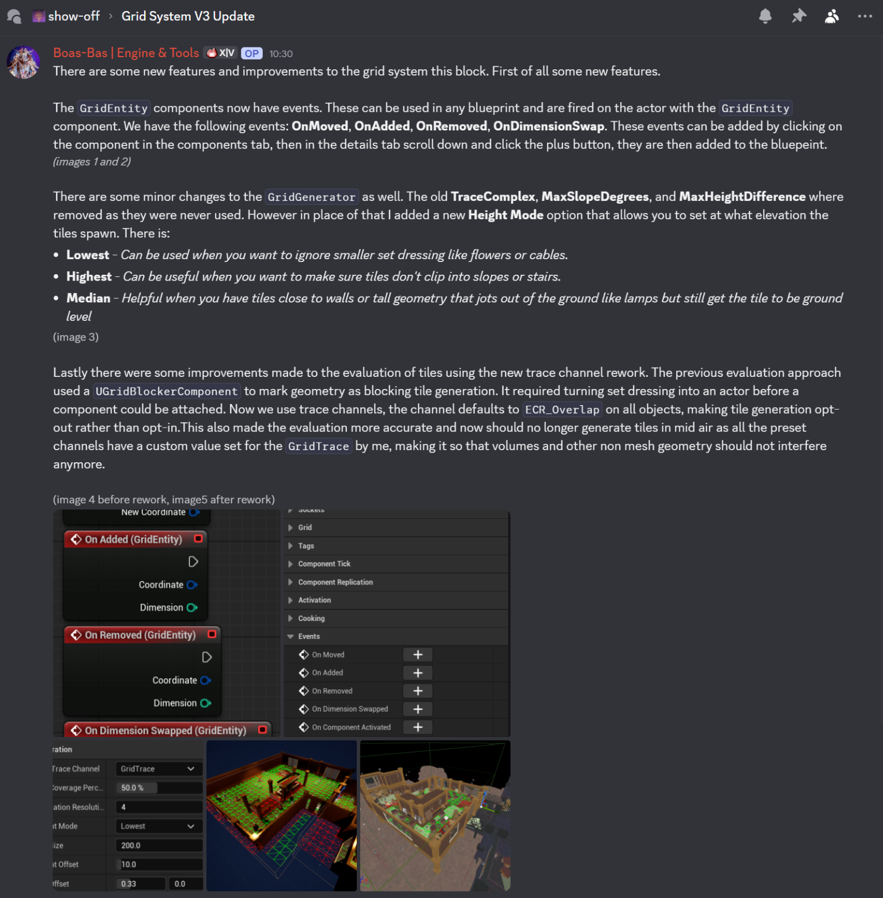
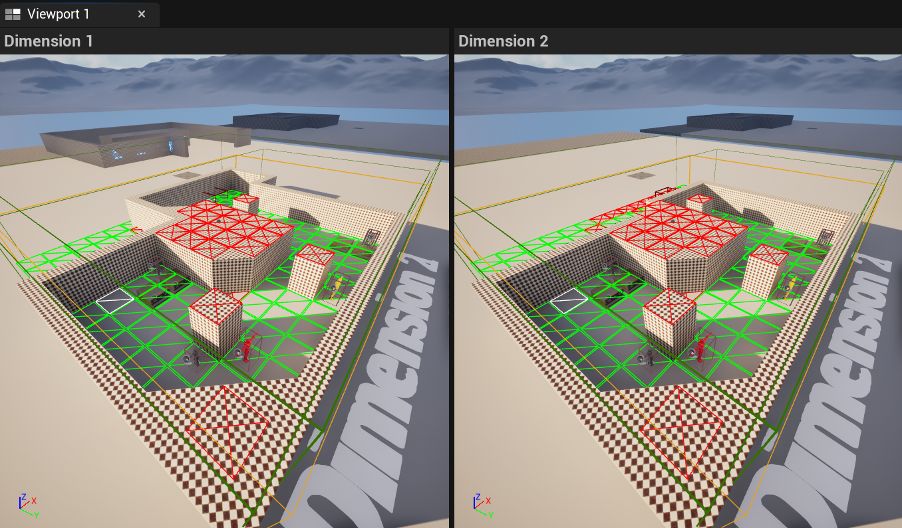

## Overview

PhaseBreak is a turn-based tactical heist game made in Unreal Engine 5. The level exists in two dimensions at the same time, and you swap between them to get past enemies and obstacles. Warping into a spot that's occupied in the other dimension even damages whatever is standing there.

It was the team project for the last three blocks of my third year at Breda University of Applied Sciences, made by 27 people: a producer, 7 designers, 7 programmers and 12 artists. The game is released on Steam.

Trailer or a short gameplay GIF: a unit moving across the grid, swapping dimension, and the level changing around it.

---

## What I Did

I owned the backend of the grid system: generating the grid from the level, handling both dimensions, and saving it so designers can edit it. Everything that moves or stands on the grid, from the units to the covers, goes through it.

### Grid System

Level designers build their level, drop a volume over it and get tiles that follow the geometry. The grid works for both dimensions at once, knows which dimension each piece of geometry belongs to, and only updates the tiles that changed when something moves, so dragging a volume around stays fast.

<video src="/assets/video/projects/phasebreak/grid_volume_tile_generation.mp4" width="100%" autoplay muted loop playsinline controls title="A grid volume generating tiles from the level"></video>

<a href="/blogs/phasebreak-grid-system/" class="article-button"><i class="fas fa-newspaper"></i> Read the article</a>

### Designer Tooling

An editor mode where designers click tiles in the viewport to make them valid or invalid. Their changes stay when the volume moves or the grid rebuilds, and each level's grid is saved in its own data asset, so they get the normal "unsaved changes" flow instead of a separate save button.

<video src="/assets/video/projects/phasebreak/automatic_data_asset_saving_on_tile_changed.mp4" width="100%" autoplay muted loop playsinline controls title="Changing tiles in the tile editor mode"></video>

Tiles a designer changed by hand stay the way they set them, even when the volume moves.

<video src="/assets/video/projects/phasebreak/grid_keep_modified.mp4" width="100%" autoplay muted loop playsinline controls title="Hand-edited tiles staying when the volume moves"></video>

The settings for how the grid gets generated, like the tile size, how much of a tile needs to be covered and which height to use, are all on the grid generator, so designers can tune them per level.

### Helping the Team Use the Grid

Because almost every system in the game uses the grid, a lot of my work was helping others use it. Robin, for example, came to me with questions while working on his AI tool, like how to clear an occupant without destroying its grid entity component, and how to get all tiles of a type in the editor. Timmy asked me to help with a performance issue in `DrawGrid`, which we fixed together over a call. Late in the project I also added events for when something on the grid gets added, moved, removed or swaps dimension, so other systems can react to that instead of recalculating everything.

  

  

### Shipping the Game

In the final block I mostly fixed bugs to get the game ready for release. That included packaging failures, the grid data not loading when going from one level to another, visual effects not showing on top of the tile they were aimed at, the undo and redo buttons still working while an action was selected, and the telefrag health preview staying visible after swapping dimensions.

