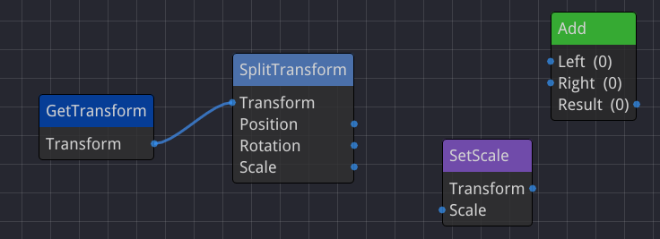
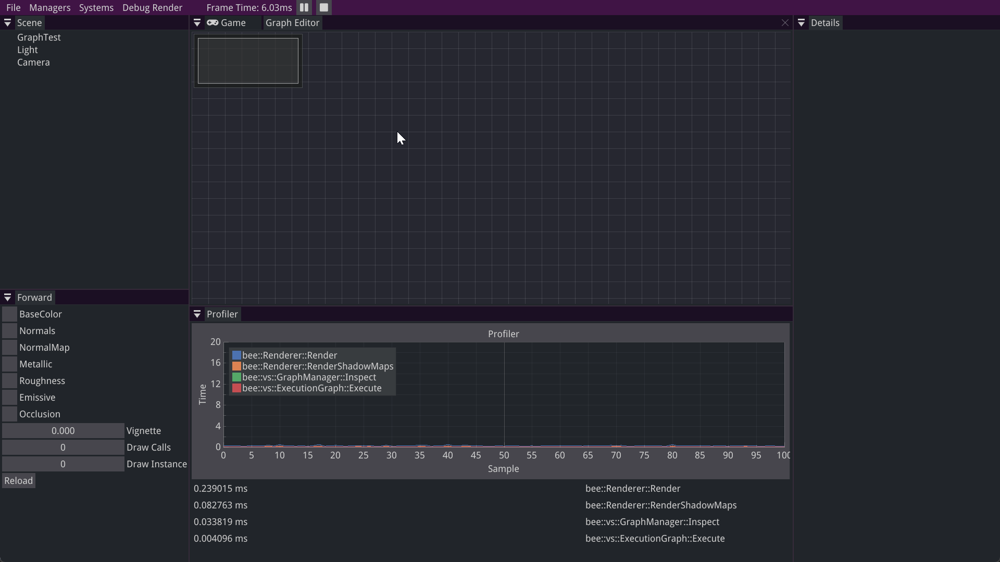
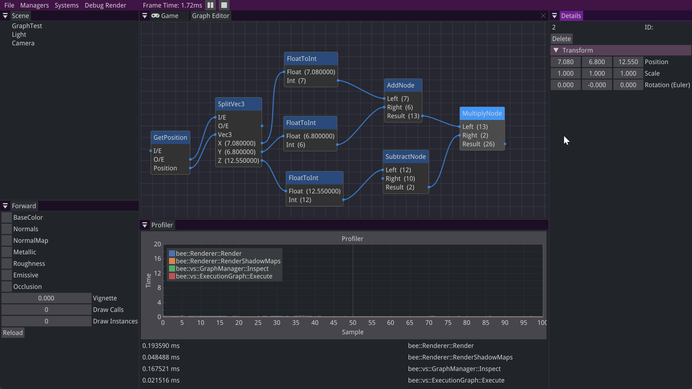
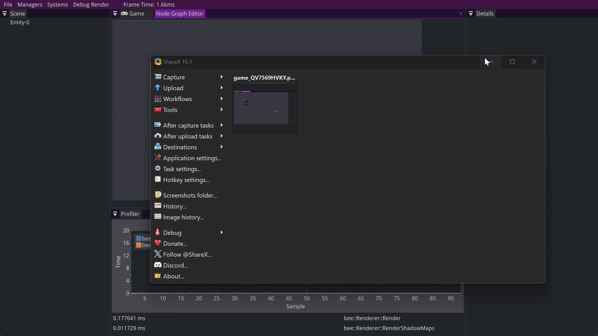

## Overview

A visual scripting language for the Bee engine, mainly inspired by Unreal Engine's Blueprints. It was my self-study project for the second block of my second year at Breda University of Applied Sciences, so it was solo and I picked the topic myself. The goal was a system where you build logic by connecting nodes, with an easy to use API for adding new nodes in C++.

---

## What I Did

### Nodes and Pins

Every node has typed input and output pins, and a new node type is just a small C++ class. Add the pins as members, register them, and write what the node does in `Execute`. Pins can be used like the data they hold, so a multiply node is just `m_result = m_left * m_right`.
For an in-depth explanation you can check out the article I wrote about it.

<a href="/blogs/storing-dynamic-data-types/" class="article-button"><i class="fas fa-newspaper"></i> Read the article</a>

### The Graph Editor

The graph is drawn with the imnodes library. You add nodes from a right-click menu grouped by category, and drag between pins to connect and disconnect them. New node types show up in that menu automatically once they're registered with a macro.

### Running the Graph

A graph is a component on an entity. I added play, pause and step buttons to the engine, and when you press play, every graph sorts its nodes with a topological sort based on the connections, and then runs them in that order every frame while the game is playing.

Nodes can also get the components of the entity their graph is on, like its `Transform`.

---

## How It Went

Honestly, this project didn't go the way I planned, and it isn't finished.

I lost a lot of time early on. My first node editor library, imgui-node-editor, had a weird offset on the graph depending on how far you zoomed in and where you moved to. After a while I found out it hadn't been updated in two years and depended on a version of ImGui from a branch that never got merged, so I switched to imnodes. On top of that, I kept reworking the nodes and pins because I wasn't happy with them, instead of working on what had priority. Because of both, I had to change my milestones twice.

_A gif of the old library I used to visualize the underlying types and classes._

Saving and loading graphs never made it in. With all the pointers, templates and connected parts it had become a big mess, and after talking about priorities with my lecturer I dropped it in the last week to focus on the nodes actually working. I also had to scale down the stress test, because I didn't have the setup to properly compare a graph against the same code written in C++.

I'm still not fully happy with how it turned out. A lot of it is template types and fixed pins, and I would have liked to do more with it. But it did teach me how much planning matters, and that wanting the code to be perfect can get in the way of actually finishing it.
