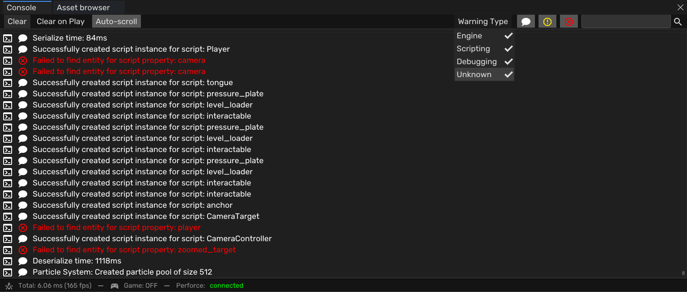
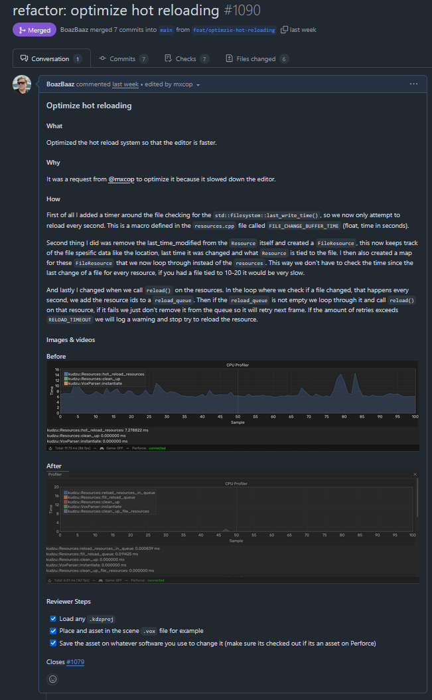
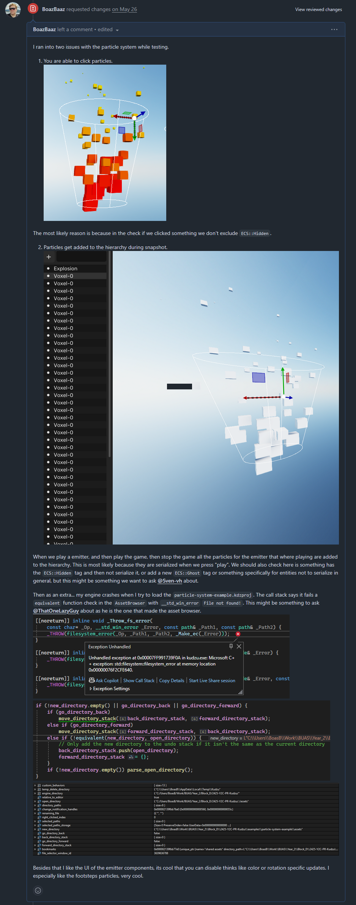

## Overview

Zentera is a voxel puzzle platformer where you play as Gori, a lizard who uses his tongue to push, pull and swing through small diorama-like worlds. It was the final project of my second year at Breda University of Applied Sciences, made in eight weeks by a team of 16 programmers, designers, artists and a producer. We built it in **Kudzu**, a custom C++/Vulkan voxel engine, and released it on itch.io together with the full engine source code.

  <iframe src="https://www.youtube.com/embed/Z_Zsby4ZBBI" title="Zentera trailer" frameborder="0" allow="accelerometer; autoplay; clipboard-write; encrypted-media; gyroscope; picture-in-picture; web-share" referrerpolicy="strict-origin-when-cross-origin" allowfullscreen></iframe>

---

## What I Did

I was on the engine side of the team, building tools for the rest of the team and fixing engine bugs. In the first sprints I was in the level feature team, but since I was mostly working on the engine, I moved to the engine feature team from the third sprint on.

### Engine Console

A console that captures everything the engine and its libraries print, writes it to a log file, and shows it in the editor with filters and search. Gameplay programmers used it all the time to check their scripts, and for artists and designers without a debugger, the log file was the way to find out why something crashed.

<a href="/blogs/zentera-engine-console/" class="article-button"><i class="fas fa-newspaper"></i> Read the post</a>

### Hot Reloading

Artists and designers can edit a voxel model in MagicaVoxel, save it, and see it update in the engine right away. This replaced a planned blockout tool, since designers could now block out levels in MagicaVoxel instead. Near the end of the project I redesigned it to make it about 910 times faster.

<video src="/assets/video/projects/zentera/hot_reload.mp4" width="100%" height="100%" controls title="Saving a model in MagicaVoxel and seeing it update in the editor right away"></video>

<a href="/blogs/zentera-hot-reloading/" class="article-button"><i class="fas fa-newspaper"></i> Read the post</a>

### PlayStation 5 Support

> *Due to NDA restrictions, details on the PS5 work are limited.*

I fixed the scripting engine so it worked on PS5, and made packaging a PS5 build run on a background thread, so the editor stays usable while it packages and shows the status in the toolbar.

<video src="/assets/video/projects/zentera/ps5_packaging.mp4" width="100%" height="100%" controls title="Packaging a PS5 build in the background, with the progress shown in the toolbar"></video>

### Source Control and Code Review

The engine programmers worked in GitHub, with our own agreements for branches, commits and pull requests, while the rest of the team worked in Perforce. Every change went through a pull request that someone else had to review and approve before it could be squashed and merged.

Over the block I opened 20 pull requests and reviewed 19 from other engine programmers, requesting changes on 7 of them. For Zhangir's particle system, for example, I found two bugs while testing it. You could click on particles in the viewport, because the click check didn't skip entities with the `ECS::Hidden` tag, and after playing and stopping the game, all the particles ended up in the hierarchy, because they were saved when you pressed play. We went through a few rounds of fixes and re-reviews, and I only approved it once I couldn't find anything wrong after testing it.

  

  

### Bug Fixes

I reported 10 bugs and fixed 9 of them. The biggest was UI buttons registering clicks in the wrong place. Sven found it and asked me to look at it, and it turned out to be a lot bigger than expected. Some of the `Transform` functions weren't returning the scale and rotation in the format the rest of the engine expected. Fixing that unblocked the UI work.

I also fixed building and packaging the game for PS5. Jaeden made that system but was busy with the animation system, so he assigned the bug to me. The paths in the Python script were wrong, so the generated package file had invalid paths. When Lynn reviewed the fix it still didn't work for her, and it turned out she had an older version of the SDK.

To help find bugs, I added an FPS limiter, so we could test how the game ran on lower end hardware. That helped us find issues in the physics.

<video src="/assets/video/projects/zentera/fps_limit.mp4" width="100%" height="100%" controls title="Limiting the frame rate to test how the game runs on lower end hardware"></video>
