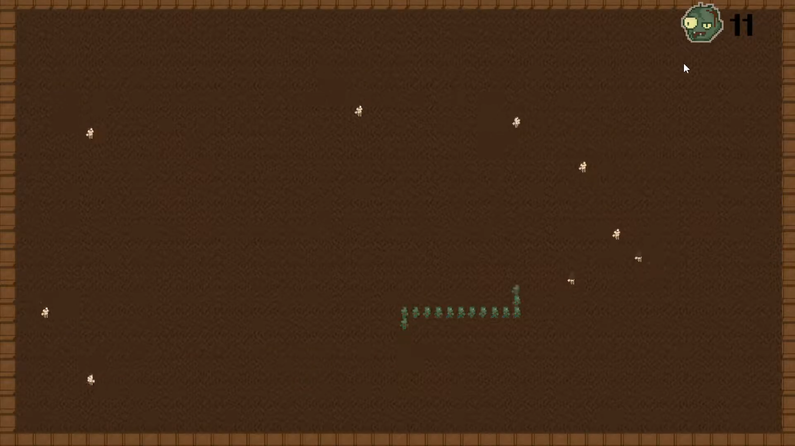

## Overview

ZombieZnake was made in 5 days for the **International Educations Game Jam 2021**, with the theme "...and zombie". The team was international, with two programmers and three artists from the Netherlands and Sweden. You play as a zombie walking around a town. Infect humans to grow your chain of zombies, but don't run into your own tail. The game placed **26th out of 34** entries.

---

## What I Did

### Grid and Movement

I built the grid and the movement from scratch instead of using Unity's physics. Every tick the head of the snake moves one tile, and every zombie behind it moves to where the one in front of it was, with its own directional sprite.

A short GIF of the zombie chain moving through the town and turning corners.

### Infection and Collision

All collisions are done by comparing grid positions. Moving off the grid or into your own tail kills you, and moving onto a human infects them, adding a new zombie to your chain and to your score.

A GIF of infecting a few humans and the chain growing.

Looking back, building it all on Unity's physics would have been more practical for a 5-day jam. But doing it myself taught me a lot about what an engine normally does for you.
